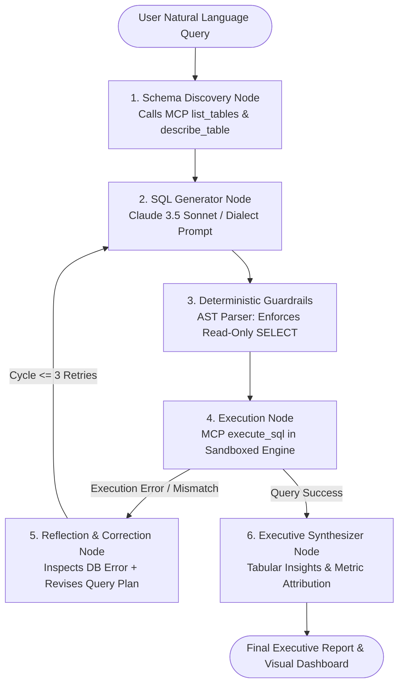

# ⚡ Autonomous Database Reasoning Agent via Model Context Protocol (MCP) & LangGraph

[](https://www.python.org/)
[](https://modelcontextprotocol.io/)
[](https://langchain-ai.github.io/langgraph/)
[](https://duckdb.org/)
[](https://github.com/Sayad786/autonomous-mcp-sql-agent)
[](LICENSE)

An enterprise-grade, autonomous SQL reasoning agent utilizing Anthropic's **Model Context Protocol (MCP)** and a **LangGraph Cyclical State Machine** with self-healing reflection loops. Connects large language models (Claude 3.5 Sonnet) to complex enterprise data warehouses without schema hallucination, destructive SQL operations, or brittle runtime failures.

---

## 🏛️ System Architecture



---

## 🚨 The Production Problem: Why Naive Text-to-SQL Breaks

Most tutorial "Text-to-SQL" implementations fail catastrophically in enterprise environments:
1. **Schema Hallucination:** Naive prompts dump entire schemas or guess column names (`gross_sales` vs `annual_contract_value_usd`), resulting in fatal binder errors.
2. **Brittle Runtime Failures:** A single missing quote or dialect difference crashes the pipeline, returning raw stack traces to end users.
3. **Security Vulnerabilities:** Naive agents have executed destructive statements (`DROP TABLE`, `UPDATE`, `DELETE`) or runaway queries causing database denial of service.

### How This Architecture Solves It:
* **Model Context Protocol (MCP):** Implements Anthropic's open-standard MCP server. Tools (`list_tables`, `describe_table`, `execute_sql`, `explain_sql`) expose warehouse metadata dynamically on-demand, preventing context window bloat and schema confusion.
* **LangGraph Cyclical StateGraph:** If an execution fails, the agent intercepts the exact database error, enters a **Reflection Node**, diagnoses the schema constraint, and autonomously rewrites the query (up to 3 self-correction iterations).
* **Deterministic Guardrails:** AST and token-based validation blocks non-`SELECT` statements, multi-statement injection vectors, and runaway table scans.

---

## 📂 Repository Structure

```
autonomous-mcp-sql-agent/
├── app.py                      # Interactive Streamlit dashboard with live trace viewer
├── main.py                     # Command-line interface with execution trace logging
├── requirements.txt            # Production dependencies (Anthropic, DuckDB, LangGraph, etc.)
├── data/
│   ├── seed_enterprise_db.py   # Enterprise B2B SaaS warehouse seeder (Accounts, Leads, Campaigns)
│   └── enterprise_warehouse.duckdb # In-memory / embedded high-speed columnar database
├── src/
│   ├── config.py               # Operational parameters, timeouts, and API keys
│   ├── db_engine.py            # Sandboxed read-only database execution layer
│   ├── guardrails.py           # SQL AST security and injection filters
│   ├── mcp_server.py           # Anthropic Model Context Protocol (MCP) server
│   ├── agent_state.py          # Typed Pydantic StateGraph memory schema
│   └── agent_graph.py          # LangGraph cyclical nodes (Discovery -> Gen -> Exec -> Reflection)
└── tests/
    └── test_agent.py           # Pytest suite covering MCP tools, guardrails, and self-correction
```

---

## ⚡ Quick Start

### 1. Clone & Set Up Virtual Environment
```bash
git clone https://github.com/Sayad786/autonomous-mcp-sql-agent.git
cd autonomous-mcp-sql-agent

python3 -m venv venv
source venv/bin/activate
pip install -r requirements.txt
```

### 2. Seed the Enterprise Warehouse
```bash
python data/seed_enterprise_db.py
```
*Populates 100 enterprise accounts, 300 lead lifecycle records with attribution, 10 marketing campaigns, and active subscription MRR.*

### 3. Run via CLI
```bash
python main.py "Find all high-intent leads that leaked through our marketing pipeline without sales follow-up"
```

### 4. Launch Streamlit UI
```bash
streamlit run app.py
```

---

## 🧪 Automated Test Suite

Run the full unit and integration test suite verifying guardrail security, MCP tool dispatch, and self-correction:
```bash
pytest -v tests/
```

Output:
```text
tests/test_agent.py::test_guardrails_allow_valid_select PASSED           [ 12%]
tests/test_agent.py::test_guardrails_block_drop_table PASSED             [ 25%]
tests/test_agent.py::test_guardrails_block_delete_from PASSED            [ 37%]
tests/test_agent.py::test_guardrails_block_multi_statement_injection PASSED [ 50%]
tests/test_agent.py::test_mcp_list_tables PASSED                         [ 62%]
tests/test_agent.py::test_mcp_describe_table PASSED                      [ 75%]
tests/test_agent.py::test_agent_end_to_end_execution PASSED              [ 87%]
tests/test_agent.py::test_agent_self_correction_reflection PASSED        [100%]

============================== 8 passed in 0.31s ===============================
```

---

## 💡 Technical Interview Talking Points

### 1. Why use Model Context Protocol (MCP) instead of hardcoding database tools?
Hardcoding prompts creates an $M \times N$ integration nightmare where every tool has custom schemas and prompt templates. Anthropic's Model Context Protocol (MCP) establishes a standardized, client-server protocol. The model discovers database tools (`describe_table`, `execute_sql`) through typed JSON schemas and executes them via isolated, standardized interfaces that can connect identically to DuckDB, PostgreSQL, or Snowflake.

### 2. Why LangGraph instead of a linear LangChain chain?
Real databases return unexpected edge cases: column name mismatches, type coercions, and division-by-zero errors. A linear chain (`Prompt -> Model -> DB`) fails immediately on the first error. LangGraph enables a **cyclical state machine** with conditional edge routing: if `execution_result['success'] == False`, state transitions to a `ReflectionNode` that analyzes the error traceback, adjusts memory, and re-routes back to `SQLGeneratorNode` for self-correction.

### 3. How do you prevent malicious or high-cost SQL execution?
We implement a defense-in-depth model:
1. **Connection-level:** DuckDB instance is instantiated with `read_only=True`.
2. **AST Guardrail:** `sqlparse` token analysis rejects non-SELECT statements, multi-statement queries, and prohibited keywords (`DROP`, `ALTER`, `TRUNCATE`, `DELETE`, `UPDATE`).
3. **Execution-level:** Hard statement timeouts (10s) and automatic `LIMIT 100` injection prevent runaway memory exhaustion.

---

## 👨‍💻 Author & Connect
* **Sayad Khalid Uddin** – [LinkedIn Profile](https://www.linkedin.com/in/sayad-khalid/)
* Specialist – Data Engineering (AI & Data Platforms) | LTIMindtree

---

## 📄 License
MIT License. Built for enterprise AI engineering architectures.
